# Helm Remote Desktop

Remote Desktop Connection (**mstsc**) style RDP client for **Rocky Linux 9 and 10**,
part of the Anderson Computer cyber chief toolset with
[Skiff](https://github.com/mike0615/skiff) (SFTP),
[Sonar](https://github.com/mike0615/sonar) (network scanner) and
[Porthole](https://github.com/mike0615/porthole) (multi-SSH).

Type a computer name, press **Connect**, enter your credentials. **Show Options**
opens the same five tabs as the Windows client. Sessions are drawn by
**FreeRDP** from Rocky's own AppStream repository (FreeRDP 2.11 on Rocky 9,
FreeRDP 3 on Rocky 10), so there is nothing extra to trust or compile.

**Who it's for:** Administrators used to Windows' Remote Desktop Connection (mstsc) who want an RDP client with the same options tabs on Rocky Linux 9 and 10.

The package, command and repository are named **`helm-rdp`** so they never clash
with the Kubernetes `helm` package in EPEL.

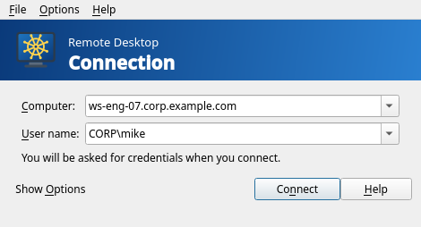

| General | Display | Local Resources |
|---|---|---|
| 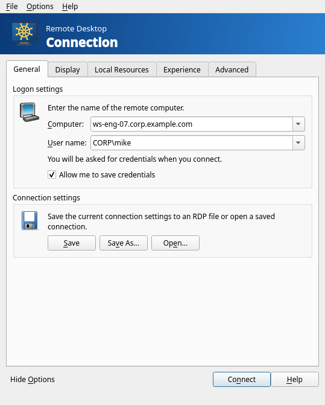 | 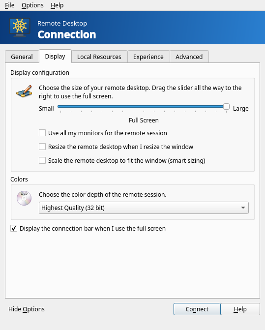 | 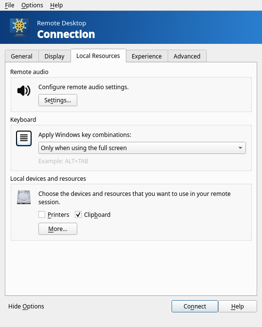 |

| Experience | Advanced | Certificate warning |
|---|---|---|
| 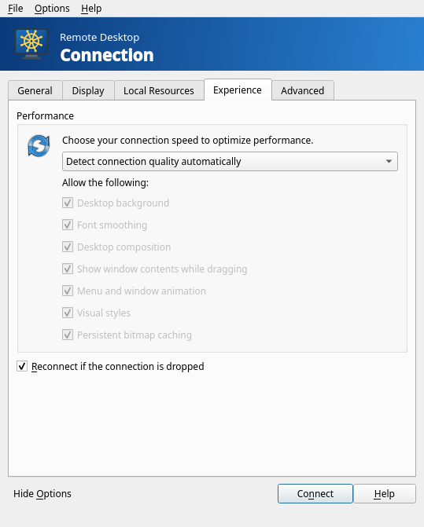 | 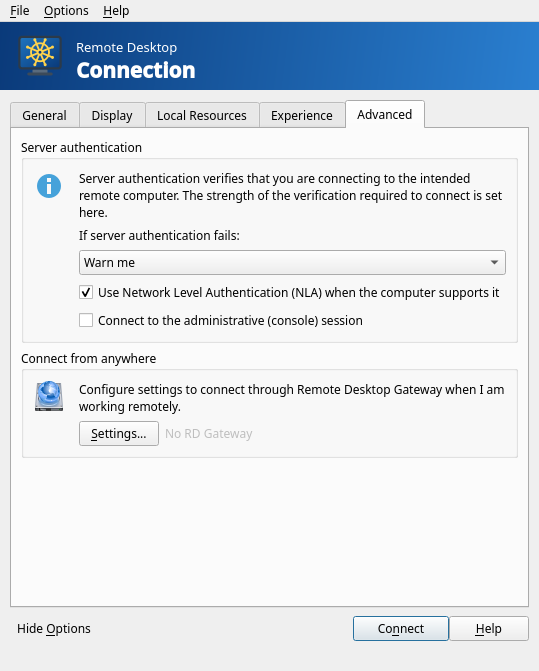 | 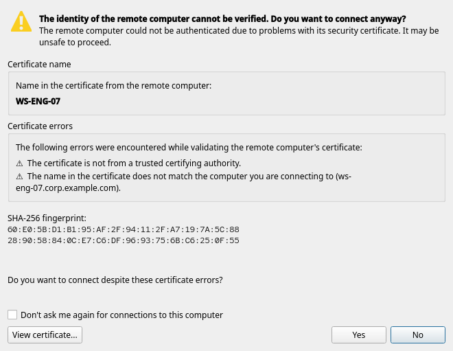 |

| Credentials | About | A live session (xrdp test server) |
|---|---|---|
| 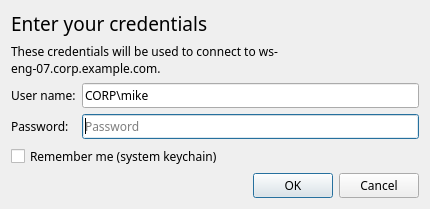 | 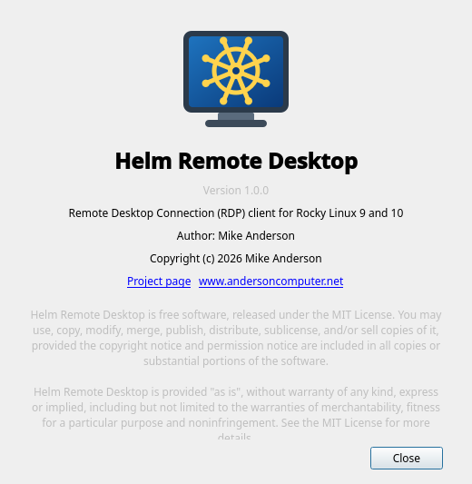 | 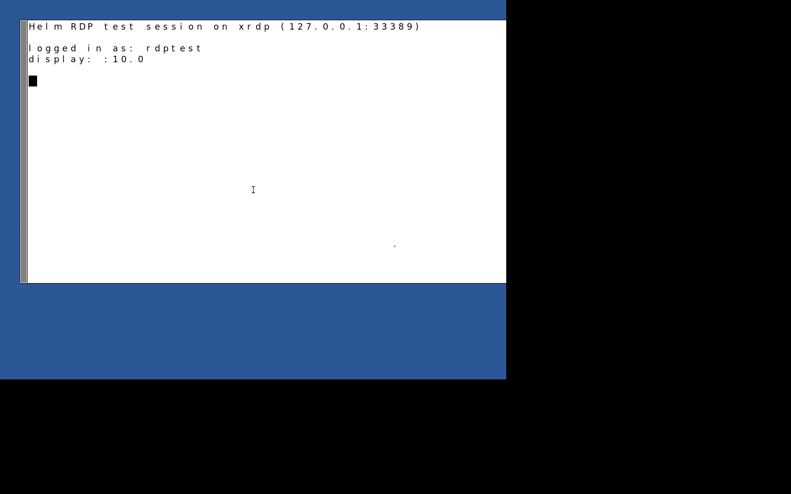 |

| Logon failed, re-prompt | Can't connect | Full-screen session with connection bar |
|---|---|---|
| 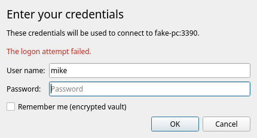 | 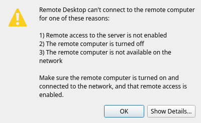 | 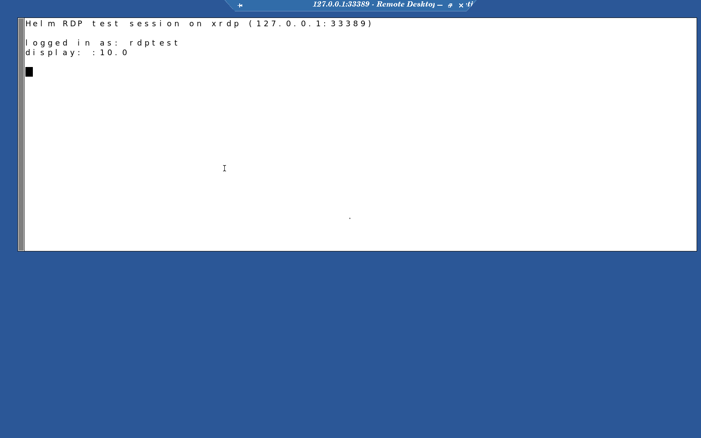 |

## Install

Download the RPMs from the [latest release](https://github.com/mike0615/helm-rdp/releases/latest), or install directly:

```
# Rocky Linux 9
sudo dnf install https://github.com/mike0615/helm-rdp/releases/download/v1.0.0/helm-rdp-1.0.0-1.el9.noarch.rpm
# Rocky Linux 10
sudo dnf install https://github.com/mike0615/helm-rdp/releases/download/v1.0.0/helm-rdp-1.0.0-1.el10.noarch.rpm
```

Every dependency is in the stock BaseOS / AppStream repositories; **EPEL is not needed**.

| | Rocky Linux 9 | Rocky Linux 10 |
|---|---|---|
| Session engine | `freerdp` 2.11 (`xfreerdp`) | `freerdp` 3.x (`xfreerdp`) |
| Qt bindings | `python3-qt5-base` | `python3-pyqt6-base` |
| Password vault, certificate parsing | `python3-cryptography` | `python3-cryptography` |
| System keychain | `python3-gobject-base`, `libsecret` | same |
| Optional (weak) | `qt5-qtsvg`, `qt5-qtwayland` | `qt6-qtsvg`, `qt6-qtwayland` |

Launch it from the desktop menu (**Helm Remote Desktop**) or run `helm-rdp`.
Double-clicking an `.rdp` file opens it in Helm and connects, like on Windows.

## What it does, mstsc by mstsc

| mstsc | Helm |
|---|---|
| Compact Computer / User name window, Show Options | Same, with a recent-computers drop-down |
| **General**: logon settings, Allow me to save credentials, Save / Save As / Open | Same; files are mstsc `.rdp` (UTF-16, keys kept in order, unknown keys preserved) |
| **Display**: size slider to Full Screen, all monitors, color depth, connection bar | Same, plus dynamic resolution and smart sizing |
| **Local Resources**: remote audio, Windows key combinations, printers, clipboard, More… (drives, smart cards) | Same; drives are your home folder, mounted media, any folder, all drives or drives plugged in later |
| **Experience**: connection speed presets and the seven visual options, reconnect | Same presets as mstsc |
| **Advanced**: server authentication (connect / warn / do not connect), RD Gateway | Same, plus NLA and admin-session switches |
| "The identity of the remote computer cannot be verified" | Same dialog with the SHA-256 fingerprint; *Don't ask me again* pins it; a changed certificate is flagged |
| Windows Security credential prompt, Remember me | Credentials window for anything missing; Remember me saves in the keychain or vault |
| `mstsc /v:host /f /w /h /admin /edit file.rdp` | Accepted as-is, plus `--host/--user/--port/--password-fd` |

## Saved passwords

Same model and wording as Skiff and Porthole (Options ▸ Passwords):

* **Automatic** (default): the system keychain when one is running, otherwise the encrypted vault.
* **System keychain** — GNOME Keyring / KWallet through the Secret Service (libsecret).
* **Encrypted vault** — `~/.config/helm-rdp/vault.json`, AES-256-GCM, key from your master
  password with scrypt; unlocked once per session, Options ▸ Lock Password Vault locks it.
* **Don't save passwords**.

A password is saved only after the logon succeeds. Passwords are keyed by computer
(`TERMSRV/pc01`, like Windows Credential Manager) and handed to FreeRDP through a
private pipe — `/args-from:fd:N` on FreeRDP 3, `/from-stdin:force` on FreeRDP 2 — so they
never appear in `ps`, `/proc/<pid>/cmdline`, the environment, `.rdp` files, settings or logs.

## Certificates

Before FreeRDP starts, Helm does the RDP security negotiation itself, reads the
server's TLS certificate and checks it against the system CA store and the
computer name. Trusted certificates connect silently. Otherwise (per the Advanced
tab setting) Helm warns, refuses, or skips the check. Whatever certificate is
accepted is pinned for that connection with `/cert:deny,fingerprint:sha256:…`, so
FreeRDP refuses any other certificate and never stops to ask on a terminal.
Options ▸ Saved Certificates lists and removes remembered certificates.

## Command line

```
helm-rdp                                  open the connection window
helm-rdp --host pc01                      connect; ask for the user name and password
helm-rdp --host 10.0.0.5 --user 'CORP\mike' --port 3390
helm-rdp work.rdp                         open an .rdp file and connect
helm-rdp --edit work.rdp                  open an .rdp file without connecting
helm-rdp --host 10.0.0.5 --user mike --password-fd 3   (password on fd 3)
helm-rdp /v:pc01:3390 /f /admin           mstsc-style switches
```

`--password-fd N` reads the password from an inherited pipe until EOF and closes it —
the same hand-off Skiff uses, so Sonar and Porthole can launch Helm with a saved
password without it touching argv or the environment:

```python
r, w = os.pipe()
subprocess.Popen(["helm-rdp", "--host", host, "--user", user, "--password-fd", str(r)], pass_fds=(r,))
os.close(r); os.write(w, password.encode()); os.close(w)
```

## Files

| Path | What |
|---|---|
| `/etc/helm-rdp/helm-rdp.conf` | Master configuration: FreeRDP binary, extra FreeRDP options, log level, time-out |
| `~/.config/helm-rdp/helm-rdp.conf` | Per-user override (same keys) |
| `~/.config/helm-rdp/settings.json` | Recent computers, password-store choice, which computers have a saved password (never the password) |
| `~/.config/helm-rdp/Default.rdp` | The default connection (like `Documents\Default.rdp`) |
| `~/.config/helm-rdp/known_certs.json` | Certificates you chose to trust |
| `~/.config/helm-rdp/vault.json` | The encrypted vault, if used |

## Not (yet) like mstsc

* RemoteApp is passed through (`remoteapplicationprogram`) but not polished; no RD Web feed / workspace subscription.
* RD Gateway "automatically detect" is not available on Linux — set the gateway explicitly. Gateway sign-in was
  not tested against a real gateway. On FreeRDP 2 (Rocky 9) the gateway must use the same or prompted credentials.
* No serial/parallel port, video capture or USB redirection; smart cards need `pcsc-lite` running.
* The session window is FreeRDP's (full screen: Ctrl+Alt+Enter, connection bar), not a tab inside Helm.
* Windows-saved passwords in `.rdp` files (`password 51:b:`, Windows DPAPI) can't be read and are dropped.
* Azure AD / Entra ID (`enablerdsaadauth`) and Kerberos KDC proxy settings are kept in the file but not used.

## Build from source

```
sudo dnf install -y rpm-build python3 desktop-file-utils python3-cryptography python3-gobject-base libsecret
./build.sh          # -> out/helm-rdp-1.0.0-1.elN.noarch.rpm, .src.rpm, tarball
./bin/helm-rdp      # run from the checkout
python3 -m unittest discover -s tests -t .        # unit tests
QT_QPA_PLATFORM=offscreen python3 tests/smoke_offscreen.py
```

## License

MIT — Copyright (c) 2026 Mike Anderson. FreeRDP is Apache-2.0 and is installed from your distribution.

---

**Part of the Cyber Chief toolkit** by Anderson Computer. Sibling projects: [Flagship](https://github.com/mike0615/flagship) · [Flagship Web](https://github.com/mike0615/flagship-web) · [Porthole](https://github.com/mike0615/porthole) · [Skiff](https://github.com/mike0615/skiff) · [Sonar](https://github.com/mike0615/sonar) · [Pathfinder](https://github.com/mike0615/pathfinder) · [FleetOps](https://github.com/mike0615/fleet-ops) · [Dockyard](https://github.com/mike0615/dockyard) · [CommShack](https://github.com/mike0615/commshack).
